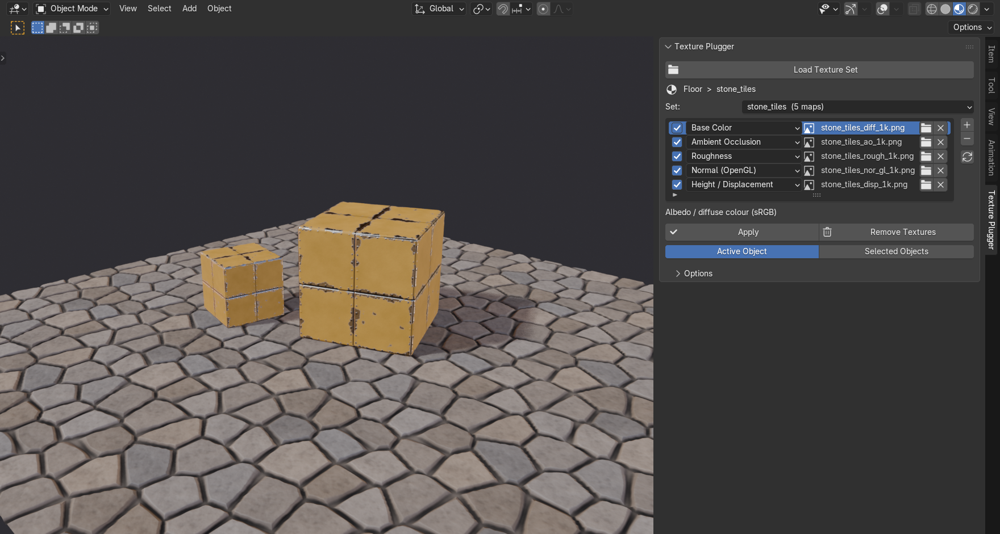

# Texture Plugger

A Blender add-on (Extension format, Blender 4.5 and 5.0+) that hooks PBR texture sets up to a
Principled BSDF material. It detects each map from its filename and wires everything up
(colour spaces, normal/bump/displacement, packed maps). Run it again and you get the same
result, never duplicated nodes. Pure Python with no dependencies. It makes no network calls.


| Before | After loading two texture folders |
|---|---|
|  |  |

## What it looks like

**1. A folder of maps.** Texture Plugger reads each filename and works out which map it is.
Both naming styles below are detected without any setup: Poly Haven style suffixes
(`_diff`, `_nor_gl`, `_disp`...) and Unreal style ones, including a packed ORM map and a
DirectX normal map.


**2. The panel.** Press **Load Texture Set** and pick the folder (or drag the images in).
Each detected map gets a row you can switch off, re-type or swap. The folder holds two
sets, so the *Set* menu lets you choose; the one with the most maps is picked first.



**3. The node tree it builds.** Everything lands in one labelled frame with a fixed
layout. The stone set gets AO multiplied into Base Color, an OpenGL normal map and real
displacement:


The metal set's DirectX normal map has its green channel flipped, and the packed ORM map is
split into AO, Roughness and Metallic:


The example textures were generated procedurally just for these screenshots. The renders
are Cycles; the panel screenshot is Blender 5.0's Material Preview.

## Install

1. Build the zip with `.\build.ps1` (or `python build.py`). This creates `dist\texture_plugger-1.1.0.zip`.
2. In Blender go to **Edit > Preferences > Get Extensions**, open the **v** menu (top right),
   choose **Install from Disk...** and pick the zip.
3. Check that **Texture Plugger** is enabled.

The same zip also installs as a legacy add-on (**Add-ons > Install from Disk**).

## Use

- **Sidebar** (`N`) > **Texture Plugger** tab, in the 3D Viewport and in the Shader Editor.
- **Load Texture Set**: you can pick several image files, or open a folder and press the
  button without selecting anything to scan the whole folder. You can also use
  **File > Import > PBR Texture Set**.
- **Drag and drop** image files onto the 3D Viewport or Shader Editor. Blender's own image
  drop handlers (e.g. *Add Image Empty* in the 3D Viewport, *Image node* in the Shader
  Editor) also accept images, so Blender usually shows a small menu: choose
  **Texture Plugger: PBR texture set**. The textures go to the active object (or the selection,
  see *Apply To*), not to the object under the mouse.
- The **slot list** shows each detected map. In each row you can:
  - turn the slot on or off
  - change the map type
  - **browse** for a different file
  - **clear** the file

  Below the list you can add/remove slots and re-detect. Press **Apply** to (re)build.
  Files the add-on doesn't recognise show up as *Unassigned*.
- If the folder holds **several texture sets**, the panel shows a *Set* dropdown. The set
  with the most maps is picked first.
- **Remove Textures** deletes only the nodes the add-on created. It also restores the
  material settings it changed. Your own nodes are never touched.
- **Apply To** decides what gets textured: the active object, or all selected objects.
  A material shared by several objects is only built once.
- **Options** (collapsed sub-panel):
  - **Material**: use the active slot, or make a new material named after the set
  - **Apply After Loading**
  - **Projection**: UV or Box/triplanar (with blend), plus texture scale
  - **AO multiply** on/off and AO strength
  - **Normal strength**
  - **Height map**: Displacement, Bump or Not connected
  - **Displacement**: scale (0.1) and midlevel (0.5)
  - **Bump**: strength and distance
  - **Transparency**: Dithered or Blended
  - **Base Color Alpha as Opacity**
  - **Emission strength**
  - **Relative paths**

## Create & Paint (Substance 3D Painter)

Use this when you want to paint the textures yourself in Adobe Substance 3D Painter and
see the result in Blender. You need Painter installed. The add-on looks for it in the
usual places; if it can't find it, set the path in the add-on preferences.

1. Select your object. Open the **Create & Paint** sub-panel in the sidebar.
2. Pick a **Folder**, tick the **maps** you want (Base Color, Normal, Metallic and
   Roughness are on by default; Emission, Alpha and Displacement are optional) and choose
   the placeholder **Size**.
3. Press **Create Texture Set**. The name is the object's material name (or the *Name* you
   typed). If the object has no material, one is created.
4. Press **Edit in Substance Painter**. Painter starts with your mesh and an export folder
   that is already set.
5. Paint. When you want to see it in Blender, in Painter use **File > Export Textures**,
   with the output template **Blender (Principled BSDF)** and the format **PNG**. Blender
   updates the material a moment after the export finishes.

Pressing **Ctrl+S** in Painter does not update Blender. It only saves the Painter project
(a `.spp` file), not the images. Blender changes only when you export.

Create Texture Set makes this layout inside the folder you picked:

```
<Folder>/
  Crate/                      one folder per texture set, named after the material
    textures/
      Crate_BaseColor.png     flat colour placeholders, plugged into the material
      Crate_Normal.png
      Crate_Metallic.png
      Crate_Roughness.png
      (Crate_Emission.png, Crate_Alpha.png, Crate_Displacement.png if ticked)
    mesh/
      Crate.fbx               your object, exported for Painter
```

The file names are exactly the ones the "Blender (Principled BSDF)" export writes, so each
export replaces a placeholder. Base Color is set up as sRGB and all the other maps as
Non-Color. Because the add-on writes the textures, the material is wired up straight away.

- **Save your project inside the set folder** (for example `Crate/Crate.spp`). The next time
  you press **Edit in Substance Painter**, it reopens that project instead of starting a new
  one. If there are several `.spp` files there, the newest one is used.
- **Existing files are never overwritten.** Pressing Create Texture Set again only adds
  missing files, and your painted textures stay as they are.
- **Auto Reload** is on by default. It checks the texture files about once a second and
  reloads any that changed on disk. Images with unsaved paint in Blender are never reloaded.
  You can switch it off and change the interval, and set the **Painter path**, in
  **Edit > Preferences > Add-ons > Texture Plugger**. The **Reload Textures** button in
  the panel reloads everything right away. **Open Folder** shows the set folder.
- **Works with Brushstroke Tools.** Brushstrokes are separate objects with their own
  material, so they render on top of the Painter textures. When a brushstrokes object is
  active, the Create & Paint buttons act on the mesh the strokes sit on. To colour the
  strokes from the Painter texture, pick the set's Base Color image as the brush
  material's colour texture; it then updates on every Painter export too.
- **Undo can't break the link.** If you press Ctrl+Z past the point where the set was
  created, the add-on puts the material, its textures and the folder link straight back
  (the files on disk were never touched). To really disconnect a material from its set
  folder, press **Unlink Texture Set** in the panel; it keeps the nodes and the files. Use
  **Remove Textures** to take the nodes out.
- **One texture set per material.** The buttons always work on the active material of the
  active object. If an object has several materials, create one set per material by
  switching the active material slot. A second material with the same name gets
  `_2` (so `Crate_2`), because Painter names the set after the material.
- Don't rename the material after creating the set: Painter would export files with the new
  name and the placeholders would not be replaced (the add-on warns you).

## What gets built

| Map | Wiring | Colour space |
|---|---|---|
| Base Color / Albedo / Diffuse | Base Color (optionally × AO through a Mix Multiply) | sRGB |
| Ambient Occlusion | multiplied into Base Color | Non-Color |
| Metallic, Roughness, Specular (to *Specular IOR Level*) | direct | Non-Color |
| Gloss / Smoothness | Invert to Roughness | Non-Color |
| Normal OpenGL | Normal Map node to Normal | Non-Color |
| Normal DirectX | Separate Color, then G = 1 − G, then Combine Color, then Normal Map | Non-Color |
| Bump | Bump node chained after the Normal Map | Non-Color |
| Height / Displacement | Displacement node to Material Output (method *Displacement and Bump*) | Non-Color |
| Emission | Emission Color (strength is set to 1 if it was 0) | sRGB |
| Opacity / Alpha | Alpha (render method Dithered/Blended, transparent shadows on) | Non-Color |
| Transmission, Subsurface, Sheen, Coat, Coat Roughness, Anisotropy (+ rotation) | the matching *… Weight* inputs | Non-Color |
| Sheen Tint | Sheen Tint | sRGB |
| Packed ORM/ARM, RMA, MRA, HDRP MaskMap, Metallic-Smoothness | Separate Color (+ image alpha) into the right inputs | Non-Color, channel-packed alpha |

Colour maps stored as EXR stay linear instead of sRGB.

All image nodes share one *Texture Coordinate* node and one *Mapping* node. Everything sits
in a labelled frame with a fixed, repeatable layout. UDIM sequences (`name.1001.png`, or
`name_1001.png` when there are at least two tiles) load as one tiled image. Images that are
already loaded are reused instead of being loaded twice.

## Detection

Filenames are split on `_ - . space` and on camelCase. Keywords only match whole tokens
(or runs of whole tokens, so `Base_Color`, `BaseColor` and `basecolor` all match).

- **Which match wins:** the one closest to the end of the name, because map suffixes come
  after the set name. So `Metal_Plate_ao` is AO, not Metallic. On a tie, the longer,
  more specific keyword wins (`Sheen_Color` is Sheen Tint).
- **Single letters** (`_d`, `_n`, `_r`, `_m`, `_s`, `_h`) only count as the final suffix.
- **Tokens that are ignored:** resolution (`1k`…`16k`, `2048`), format (`png`, `jpg`…),
  `LOD0`, `VAR1` and bit depth (`16bit`, `NRM16`).
- **Choosing between duplicates:** first by preferred resolution, then by format priority
  (default: EXR first for normal/height, otherwise PNG > TIFF > TGA > EXR > JPG), then no
  variant, then higher bit depth.
- **Normal maps:** if neither OpenGL nor DirectX is named in the file, the preference
  setting decides (default OpenGL).

Naming conventions covered: Poly Haven, ambientCG, Quixel/Megascans, Substance,
Textures.com, FreePBR, Poliigon and Unreal/Unity suffixes. Every keyword list can be
edited in the add-on preferences, and there's a reset-to-defaults button.

## Development

```
python tests\test_detection.py          # pure-Python detection tests (no Blender)
python tests\test_scaffold.py           # pure-Python Create & Paint scaffolding tests (no Blender)
.\tests\run_blender_tests.ps1           # headless Blender test (isolated user dir)
.\tests\run_blender_tests.ps1 -Legacy   # same, loaded as a legacy add-on
.\tests\run_blender_tests.ps1 -Script adversarial_test.py   # drop path, reload, linked data...
.\tests\run_blender_tests.ps1 -Blender "C:\...\Blender 4.5\blender.exe"
.\build.ps1 -Test                       # build + validate manifest + all tests
```

The headless test sets `BLENDER_USER_RESOURCES` to a temporary folder, so your real
Blender preferences and extensions are never changed.

## Known limitations

- Applying the textures replaces any links you had going into the Principled BSDF inputs
  it uses (and into the Output's Displacement input). **Remove Textures** does not put
  those links back.
- The add-on wires into a Principled BSDF only. If the Material Output is driven by a
  different shader, a Principled BSDF is still created and textured, but it is not
  connected to the output (you'll get a warning).
- Tangent-space normal maps with Box projection are only approximate.
- Linked materials, library-override materials and objects whose mesh/curve data is linked
  are read-only: they are skipped with a message.
- Images that the add-on's removed nodes leave unused are deleted on re-apply/Remove
  (unless they have a fake user or unsaved paint).
- Create & Paint: Painter must export with the "Blender (Principled BSDF)" template as PNG.
  With any other template the file names don't match and Blender won't pick them up.
- Create & Paint: if you change the geometry in Blender after the project was started, the
  mesh is not updated in Painter. Re-import the mesh in Painter (the add-on exports it again
  to `mesh/` each time you press **Edit in Substance Painter** without a saved `.spp`).
- The file browser and the drop menu need an interactive Blender. The headless tests
  call `wm.drop_import_file` and the import operator with `INVOKE_DEFAULT` the way Blender
  does, but they can't click the menu.
